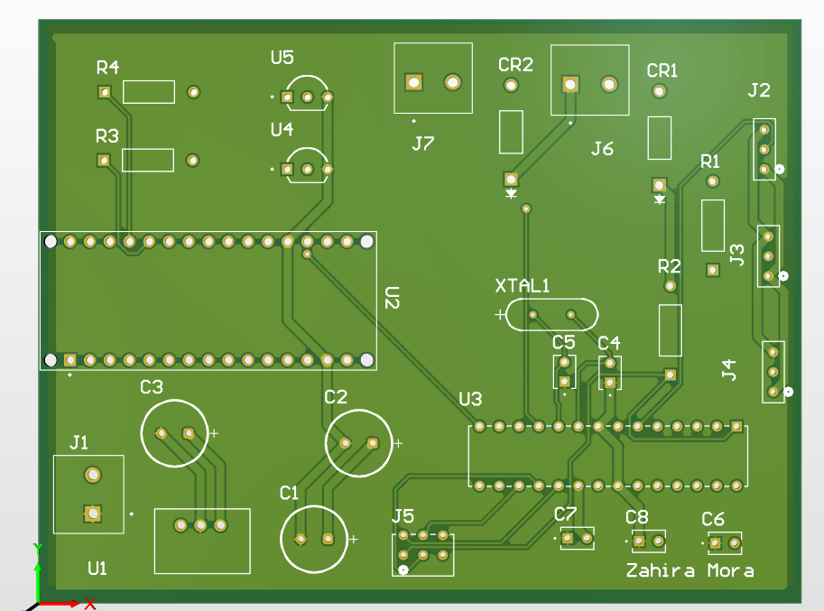
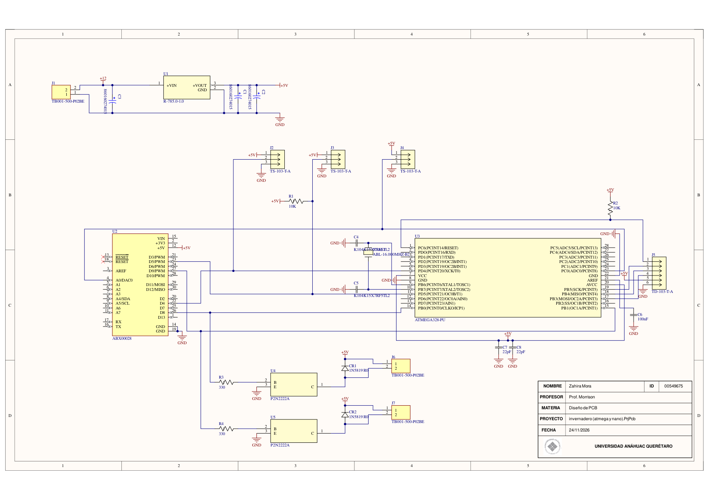
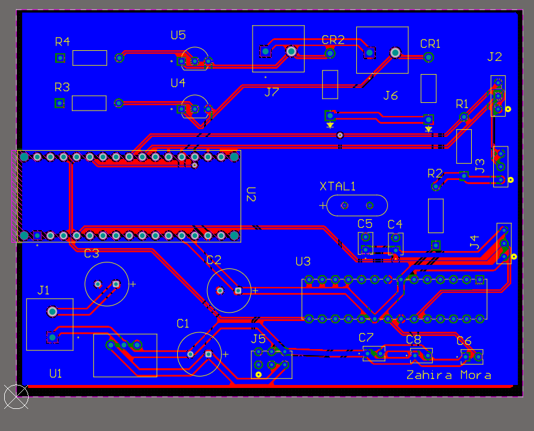

# Controlador de invernadero con ATmega328P y Arduino Nano

Proyecto final de **Diseño de PCB**, Ingeniería Mecatrónica, Universidad Anáhuac Querétaro.
Autora: Zahira Mora · Profesor: Prof. Morrison

Es una PCB de dos capas que controla un invernadero pequeño. La placa lee la luz, la temperatura y la humedad del aire, y la humedad de la tierra, y con esas lecturas prende una bomba para regar y un ventilador. Tiene lugar para dos controladores que usan las mismas señales, y solo se monta uno de los dos:

- **ATmega328P (U3)** montado desde cero, con cristal de 16 MHz y conector ICSP para programarlo.
- **Arduino Nano (U2)** como respaldo, por si el ATmega no funciona.

## Esquemático

## PCB

Capa superior en rojo y capa inferior con plano de tierra en azul. El DRC no marcó violaciones ni advertencias ([reporte](hardware/altium/outputs/DRC_pcb.html)).

El esquemático, la PCB y el stack de capas también están en PDF: [invernadero_esquematico_y_pcb.pdf](docs/invernadero_esquematico_y_pcb.pdf).

## Archivos

| Carpeta | Contenido |
|---|---|
| `hardware/altium/` | Proyecto de Altium Designer: `esquematico.SchDoc`, `pcb.PcbDoc` y el `.PrjPcb` |
| `hardware/altium/outputs/` | Gerbers y archivos de taladro (`gerbers_altium.zip`) y el reporte de DRC |
| `hardware/gerbers-jlcpcb/` | Gerbers de la versión que se mandó a fabricar a JLCPCB |
| `firmware/invernadero/` | Programa de Arduino |
| `docs/` | PDF e imágenes del esquemático y de la PCB |

## Conexiones

| Función | Conector | Arduino Nano | ATmega328P |
|---|---|---|---|
| Entrada de 12 V | J1 | | |
| Luz (salida digital del módulo LDR) | J2 | D4 | PD4 (pin 6) |
| DHT11 (temperatura y humedad del aire) | J3 | D5 | PD5 (pin 11) |
| Humedad de suelo (sensor capacitivo) | J4 | A0 | PC0 (pin 23) |
| Bomba | J6 | D8 | PB0 (pin 14) |
| Ventilador | J7 | D9 | PB1 (pin 15) |
| Programación ICSP | J5 | | pines 1, 17, 18 y 19 |

- Conectores de sensores (J2, J3, J4): pin 1 = +5 V, pin 2 = señal, pin 3 = GND.
- Los 12 V de entrada se bajan a 5 V con un regulador conmutado R-78E5.0-1.0 (U1).
- La bomba y el ventilador se prenden con un transistor NPN del lado bajo (U4 y U5), con un diodo en antiparalelo con el motor (CR1 y CR2) para protegerlo de los picos de voltaje.

## Lista de componentes

| Referencia | Componente |
|---|---|
| U1 | Regulador conmutado R-78E5.0-1.0 |
| U2 | Arduino Nano (opcional, en lugar de U3) |
| U3 | ATmega328P-PU con zócalo DIP-28 |
| XTAL1 | Cristal de 16 MHz |
| U4, U5 | Transistor NPN P2N2222A (TO-92) |
| CR1, CR2 | Diodo 1N5819 (también sirve 1N4007) |
| R1 | 10 kΩ, pull-up del DHT11 |
| R2 | 10 kΩ, pull-up de RESET |
| R3, R4 | 330 Ω, base de los transistores |
| C3 | 10 µF / 50 V, entrada de 12 V |
| C1, C2 | 10 µF / 16 V y 100 µF / 16 V, salida de 5 V |
| C4, C5 | 22 pF, cristal |
| C6, C7, C8 | 100 nF, AREF y desacople del ATmega |
| J1, J6, J7 | Bornera de 2 pines, paso 5.08 mm |
| J2, J3, J4 | Tira de 3 pines |
| J5 | Conector ICSP 2×3 |

## Programa

El programa está en `firmware/invernadero/invernadero.ino` y usa la librería **DHT sensor library** de Adafruit. Tiene dos modos, que se cambian desde el Monitor Serie a 9600 baudios:

- **Automático:** el ventilador se prende si la temperatura pasa de 22 °C o la humedad del aire pasa de 70 %, y la bomba riega 3 segundos cuando la lectura del suelo pasa de 600 (tierra seca).
- **Manual:** `m` entra al modo manual, `b` prende o apaga la bomba, `v` prende o apaga el ventilador y `a` regresa al modo automático.

### Programación del ATmega328P

Se usa un segundo Arduino Nano como programador (ArduinoISP):

1. Subir el ejemplo **ArduinoISP** al Nano programador y poner un capacitor de 10 µF entre su RST y GND.
2. Conectar el Nano programador al conector J5: D12 → MISO, D13 → SCK, D11 → MOSI, D10 → RESET y GND → GND. El +5 V no se conecta, porque la placa se alimenta con su propio eliminador de 12 V.
3. En el Arduino IDE elegir la placa *Arduino Nano (Old Bootloader)* y el programador *Arduino as ISP*, y dar **Burn Bootloader**.
4. Abrir el programa del invernadero y subirlo con **Sketch → Upload Using Programmer**.
